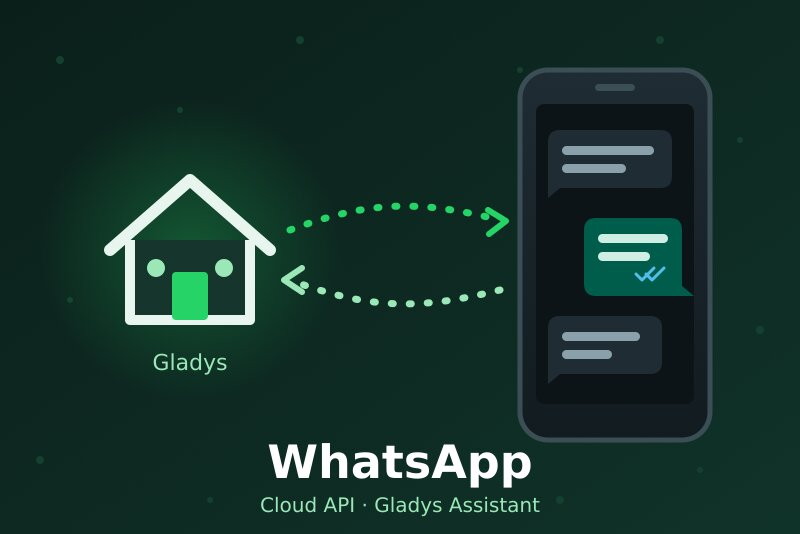
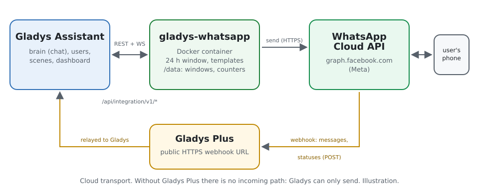
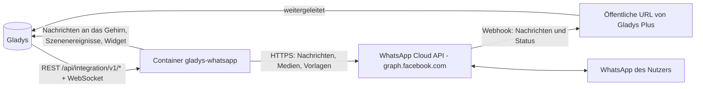
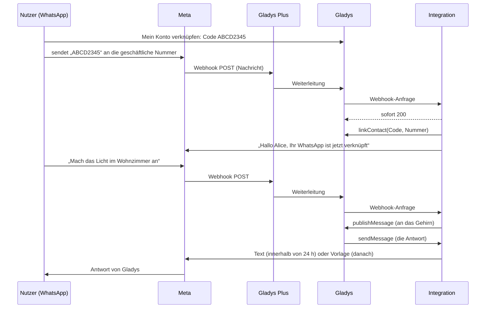
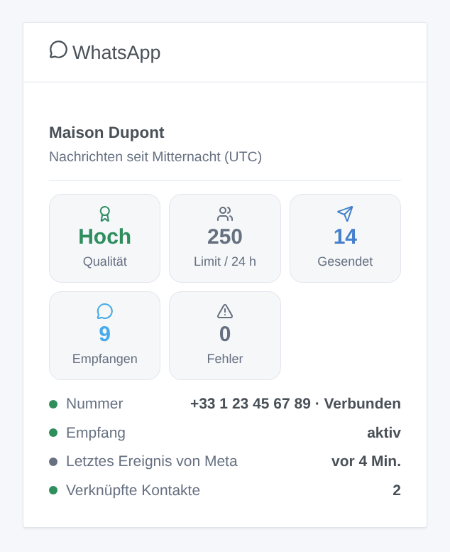

# Gladys WhatsApp

[English](README.md) · [Français](README.fr.md) · **Deutsch** · [Español](README.es.md)

[](LICENSE)
[](https://github.com/William-De71/gladys-whatsapp/releases)
[](https://github.com/William-De71/gladys-whatsapp/actions/workflows/release.yml)
[](https://gladysassistant.com)



Externe [Gladys Assistant](https://gladysassistant.com)-Integration für **WhatsApp**, über die offizielle **WhatsApp Business Cloud API** von Meta: Schreiben Sie Gladys auf WhatsApp, erhalten Sie dort ihre Benachrichtigungen und nutzen Sie WhatsApp in Ihren Szenen. Anders als CallMeBot funktioniert sie in beide Richtungen: Ihre Nachrichten erreichen das Gehirn von Gladys, das Ihnen auf WhatsApp antwortet.

Benutzerdokumentation: [English](docs/en.md) · [Français](docs/fr.md) · [Deutsch](docs/de.md) · [Español](docs/es.md).

> Community-Integration, weder mit Meta Platforms, Inc. noch mit WhatsApp LLC verbunden oder von ihnen unterstützt. Sie benötigt ein WhatsApp-Business-Konto in der Cloud API (eine Meta-App und eine geschäftliche Telefonnummer) und zum Empfangen von Nachrichten [Gladys Plus](https://gladysassistant.com/plus/).

## Funktionen

- **Chat in beide Richtungen**: Jeder Gladys-Benutzer verknüpft seine WhatsApp-Nummer mit einem Verknüpfungscode; seine Nachrichten gehen an Gladys, die Antworten und Benachrichtigungen von Gladys kommen auf WhatsApp zurück (Text sowie Bilder mit Bildunterschrift).
- **24-Stunden-Fenster berücksichtigt**: WhatsApp erlaubt freien Text nur innerhalb von 24 Stunden nach der letzten Nachricht des Nutzers. Danach sendet Gladys ihre Nachricht über eine genehmigte **Ersatzvorlage** Ihrer Wahl, auch wenn Meta das geschlossene Fenster erst nachträglich meldet.
- **Empfang über Gladys Plus**: Meta sendet die Nachrichten an die Webhook-URL von Gladys Plus; die Integration beantwortet die Prüfung von Meta selbst, verwirft Duplikate, markiert Nachrichten als gelesen (blaue Häkchen) und kann die URL selbst bei Meta registrieren.
- **Ohne Gladys Plus**: Eine Schaltfläche „Nummer ohne Gladys Plus verknüpfen“ verknüpft eine Nummer von Hand, und Gladys sendet ihre Benachrichtigungen über die Ersatzvorlage (kein Empfang).
- **Szenen**: Auslöser „WhatsApp-Nachricht empfangen“ und „WhatsApp-Nachricht nicht zugestellt“, Aktion „WhatsApp-Vorlage senden“.
- **Dashboard-Widget**: Qualitätsbewertung und Sendelimit der Nummer, Nachrichten des Tages, Status, Empfang, verknüpfte Kontakte.
- Schaltfläche **Diagnose**: was Meta und Gladys Plus melden, in die Protokolle geschrieben, mit maskiertem Token, Schlüssel und Nummern.
- Englisch, Französisch, Deutsch und Spanisch überall.

## Funktionsweise





Von der Verknüpfung bis zur Antwort:



### Transport

Nur Cloud (`transports: ["cloud"]`): Jede Nachricht läuft über die Server von Meta (`graph.facebook.com`), eingehende zusätzlich über Gladys Plus. Der Text Ihrer Unterhaltungen mit Gladys verlässt also Ihr lokales Netzwerk; so funktioniert WhatsApp.

## Nachrichten und das 24-Stunden-Fenster

| Situation                                             | Was Gladys sendet                                          |
| ----------------------------------------------------- | ---------------------------------------------------------- |
| Der Nutzer hat vor weniger als 24 Stunden geschrieben | Freien Text (und Bilder)                                   |
| Mehr als 24 Stunden, Ersatzvorlage eingerichtet       | Die Vorlage, mit dem Text als Variable                     |
| Mehr als 24 Stunden, keine Ersatzvorlage              | Freien Text, von Meta abgelehnt („nicht zugestellt“)       |
| Meta lehnt nachträglich ab (Fehler 131047)            | Einmal die Vorlage, falls eingerichtet; sonst der Auslöser |

Legen Sie die Ersatzvorlage im WhatsApp Manager an: Kategorie **Utility**, eine Variable im Text, z. B. `Gladys: {{1}}`. Meta verbietet Zeilenumbrüche in einer Variablen: Die Integration ersetzt sie durch „ · “.

## Szenenauslöser, Aktionen und Widget



- **WhatsApp-Nachricht empfangen** (Auslöser): Ein verknüpfter Kontakt hat eine Nachricht gesendet. Filter: Nachrichtentypen, Nutzlast der Schaltfläche, genauer Text. Variablen: Nummer, Profilname, Gladys-Benutzer, Typ, Text, Nutzlast, Breiten- / Längengrad, Reaktions-Emoji, Nachrichten-ID.
- **WhatsApp-Nachricht nicht zugestellt** (Auslöser): erster Fehler für eine Nummer (danach erst wieder nach einem Erfolg), mit der Ursache (außerhalb des Fensters, Nummer nicht bei WhatsApp, Vorlage abgelehnt, zu viele Nachrichten, Token abgelehnt …).
- **WhatsApp-Vorlage senden** (Aktion): eine genehmigte Vorlage an eine Nummer oder an alle verknüpften Kontakte, mit ihren Parametern (`wert1|wert2` oder `name=wert`). Ausgaben: Nachrichten-ID, WhatsApp-ID, gesendete Nachrichten.
- Widget **WhatsApp**: verifizierter Name, Qualitätsbewertung, Sendelimit, seit Mitternacht (UTC) gesendete, empfangene und fehlgeschlagene Nachrichten, Status der Nummer, Empfang, letztes Ereignis von Meta, verknüpfte Kontakte.

Beispiele:

- Wenn die Vorlagen-Schaltfläche „Tor öffnen“ (Nutzlast `OPEN_GATE`) getippt wird → das Tor öffnen.
- Wenn ein verknüpfter Kontakt seinen Standort teilt → ihn in einer Variablen speichern oder die Heizung einschalten, wenn er sich nähert.
- Wenn die Alarmanlage auslöst → die Vorlage `alarm_alert` an alle senden (sie kommt auch außerhalb des 24-Stunden-Fensters an).

## Voraussetzungen

- Gladys Assistant **5.3.0** oder neuer (Katalog-Schlagwörter und -Länder von Gladys 5.3; ältere Instanzen können die Integration nicht installieren).
- Eine Meta-App vom Typ Business mit dem Produkt WhatsApp, eine geschäftliche Telefonnummer (oder die Testnummer von Meta, die nur 5 registrierte Nummern erreicht) und ein dauerhaftes Token eines Systembenutzers (`whatsapp_business_messaging`, `whatsapp_business_management`).
- **Gladys Plus**, um Nachrichten zu empfangen (und um Nummern mit einem auf WhatsApp gesendeten Code zu verknüpfen).
- Von einem Unternehmen gesendete Nachrichten werden von Meta nach dessen Preisliste abgerechnet (insbesondere Vorlagen außerhalb des Fensters).

## Installation

- **Aus dem Store**: Integrationen → WhatsApp → Installieren.
- **Über die Repository-URL**: Integrationen → Externe Integration hinzufügen → `https://github.com/William-De71/gladys-whatsapp`.
- **Entwicklermodus**: siehe [Entwicklung](#entwicklung).

## Konfiguration

| Feld                                         | Zweck                                                                       |
| -------------------------------------------- | --------------------------------------------------------------------------- |
| Telefonnummer-ID                             | ID der geschäftlichen Nummer (WhatsApp → API-Einrichtung), erforderlich     |
| Zugriffstoken                                | Dauerhaftes Token eines Systembenutzers (geheim), erforderlich              |
| ID des WhatsApp-Business-Kontos              | Erlaubt das Registrieren des Webhooks und das Auflisten der Vorlagen        |
| Verifizierungstoken                          | Wird erzeugt, wenn leer; bei Meta mit der Webhook-URL einzufügen            |
| Webhook registrieren                         | Webhook des Kontos automatisch auf Gladys Plus richten (an)                 |
| Ersatzvorlage und Sprache                    | Vorlage außerhalb des 24-Stunden-Fensters (z. B. `gladys_notification`, de) |
| Empfangene Nachrichten als gelesen markieren | Blaue Häkchen (an)                                                          |
| Sprache der Antworten                        | Antworten, bevor eine Nummer verknüpft ist                                  |

Für den Empfang dann: Speichern Sie Ihren Open-API-Schlüssel von Gladys Plus im Block **Gladys-Plus-Webhooks**, fügen Sie in der Meta-App (WhatsApp → Konfiguration) Webhook-URL und Verifizierungstoken ein und abonnieren Sie das Feld `messages`.

## Verwendung

1. Füllen Sie die Konfiguration aus und klicken Sie auf **Verbindung testen**.
2. Erzeugen Sie unter **Mein Konto verknüpfen** einen Code und senden Sie ihn auf WhatsApp an die geschäftliche Nummer (oder geben Sie ihn ohne Gladys Plus mit Ihrer Nummer unter **Nummer ohne Gladys Plus verknüpfen** ein).
3. Schreiben Sie Gladys auf WhatsApp; fügen Sie das Widget einem Dashboard hinzu und erstellen Sie Szenen mit den Auslösern und der Aktion.

## Entwicklung

```bash
npm install
npm test                       # node --test, nie mit dem Netzwerk
npm run lint                   # ESLint
npm run format:check           # Prettier
npx github:GladysAssistant/integration-store . --skip-image-check
scripts/build-cover.sh         # cover.jpg aus docs/assets/cover.svg
docs/illustrations/render.sh   # docs/assets/widgets.<Sprache>.png
```

Lokal liest das SDK `GLADYS_HOST_API_URL`, `GLADYS_INTEGRATION_TOKEN` und `GLADYS_INTEGRATION_SELECTOR` (von Gladys im Entwicklermodus bereitgestellt). `DEBUG=gladys-integration-sdk` zeigt die Protokolle des SDK.

Die Tests decken den Client der Cloud API ab (Header, Nutzdaten der Meta-Dokumentation, Fehlercodes, Bilder, lange Texte, Vorlagenparameter), das Lesen der Webhooks, den gespeicherten Zustand, das Widget (`validateWidgetContent`), das Manifest, die vier Sprachen, das Release-Skript und die gesamte Integration gegen das falsche Gladys des SDK und eine falsche Cloud API (Verknüpfung, Empfang, Duplikate, 24-Stunden-Fenster, Ersatz, Fehler, Szenenaktion, Schaltflächen). `test/structure.test.js` friert alle gespeicherten Schlüssel ein.

## Release-Prozess


Jeder Merge auf `main` startet die CI und berechnet dann die Version aus den [Conventional Commits](https://www.conventionalcommits.org/de/) seit dem letzten Tag: `feat` → Minor, `fix` / `perf` → Patch, `!` oder `BREAKING CHANGE` → Major (ein Minor unter 1.0.0); `docs`, `chore`, `ci`, `test`, `style`, `refactor`, `build` allein veröffentlichen nichts. Der Changelog-Abschnitt wird erzeugt, der Tag gepusht, das Multi-Architektur-Image gebaut, dann erhält `main` den Release-Commit, das GitHub Release wird erstellt und ein letzter Job prüft das öffentliche Image, den Store-Validator und das Topic.

- Der Titel des Pull Requests wird zum Squash-Commit und dann zur Changelog-Zeile: Schreiben Sie ihn auf Englisch, für den Nutzer (`pr-title.yml` prüft ihn). Bearbeiten Sie `CHANGELOG.md` nie von Hand.
- 1.0.0 ist eine Entscheidung: Actions → Release → Run workflow mit `release-as: 1.0.0`. `dry-run` zeigt Version und Notizen, ohne etwas zu veröffentlichen.
- **Geschützter Branch**: Das Release pusht seinen Commit mit `GITHUB_TOKEN` auf `main`. Mit einem Ruleset auf `main` fügen Sie GitHub Actions zur Bypass-Liste hinzu (oder pushen über eine GitHub App), sonst schlägt der Publish-Job mit Anweisungen fehl.
- Machen Sie nach dem ersten Release das `ghcr.io`-Paket öffentlich (Package settings → Change visibility), sonst kann Gladys es nicht herunterladen.

## Fehlerbehebung

Siehe [docs/de.md](docs/de.md#fehlerbehebung). Melden Sie Probleme mit den Versionen von Gladys und der Integration, Ihrem Aufbau (Test- oder echte Nummer, mit oder ohne Gladys Plus) und den Zeilen der Schaltfläche **Diagnose**.

## Mitwirken

Issues und Pull Requests sind willkommen. Führen Sie `npm run format:check && npm run lint && npm test` aus, bevor Sie einen Pull Request öffnen, und ändern Sie keinen gespeicherten Schlüssel (siehe [CLAUDE.md](CLAUDE.md)).

## Sicherheit

Siehe [SECURITY.md](SECURITY.md): Melden Sie Schwachstellen vertraulich. Das Zugriffstoken ist ein `secret`-Feld, wird nur im Header `Authorization` an `graph.facebook.com` gesendet und nie protokolliert. Gladys Plus leitet keine HTTP-Header weiter, daher kann die Signatur `X-Hub-Signature-256` von Meta nicht geprüft werden: Der Webhook ist durch seine URL geschützt, die Ihren Open-API-Schlüssel von Gladys Plus enthält (ein Schlüssel, der bereits denselben Zugriff auf Gladys gewährt), durch die Prüfung der Telefonnummer-ID und durch die Verknüpfungscodes: Nur verknüpfte Kontakte erreichen Gladys. Halten Sie die Webhook-URL geheim.

## Screenshots folgen

Die Bilder oben sind Illustrationen, keine Screenshots. Echte Screenshots kommen in `docs/assets/screenshots/` (PNG, 1280 × 800): `configuration.png`, `link-account.png`, `conversation.png` (ein WhatsApp-Chat mit Gladys, 1080 × 1920), `scene.png`.

## Lizenz

[Apache-Lizenz 2.0](LICENSE) — siehe auch [NOTICE](NOTICE). WhatsApp und Meta sind Marken von Meta Platforms, Inc.; diese Community-Integration ist damit nicht verbunden. Danke an die Dokumentation und das SDK von Gladys.
