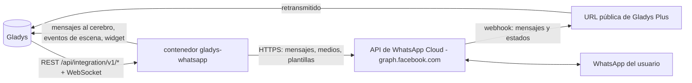
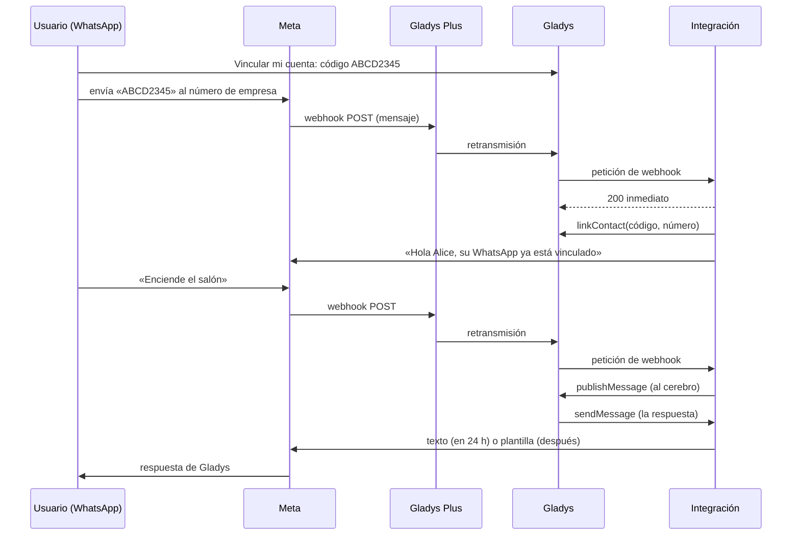
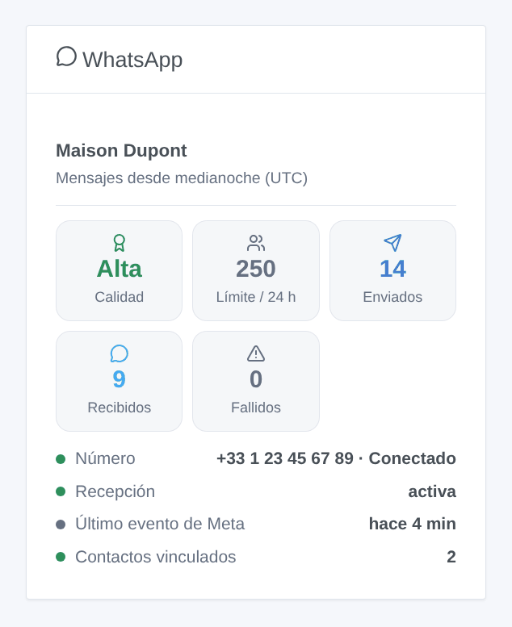

# Gladys WhatsApp

[English](README.md) · [Français](README.fr.md) · [Deutsch](README.de.md) · **Español**

[](LICENSE)
[](https://github.com/William-De71/gladys-whatsapp/releases)
[](https://github.com/William-De71/gladys-whatsapp/actions/workflows/release.yml)
[](https://gladysassistant.com)


Integración externa de [Gladys Assistant](https://gladysassistant.com) para **WhatsApp**, con la API oficial **WhatsApp Business Cloud** de Meta: escriba a Gladys por WhatsApp, reciba allí sus notificaciones y use WhatsApp en sus escenas. A diferencia de CallMeBot, funciona en ambos sentidos: sus mensajes llegan al cerebro de Gladys, que le responde por WhatsApp.

Documentación de usuario: [English](docs/en.md) · [Français](docs/fr.md) · [Deutsch](docs/de.md) · [Español](docs/es.md).

> Integración comunitaria, no afiliada ni respaldada por Meta Platforms, Inc. ni WhatsApp LLC. Necesita una cuenta de WhatsApp Business en la API de Cloud (una aplicación de Meta y un número de empresa) y, para recibir mensajes, [Gladys Plus](https://gladysassistant.com/plus/).

## Funciones

- **Conversación en ambos sentidos**: cada usuario de Gladys vincula su número de WhatsApp con un código de vinculación; sus mensajes van a Gladys, y las respuestas y notificaciones de Gladys vuelven por WhatsApp (texto, e imágenes con pie de foto).
- **Ventana de 24 horas gestionada**: WhatsApp solo permite texto libre en las 24 horas siguientes al último mensaje del usuario. Pasado ese plazo, Gladys envía su mensaje con una **plantilla de respaldo** aprobada de su elección, también cuando Meta indica la ventana cerrada a posteriori.
- **Recepción a través de Gladys Plus**: Meta envía los mensajes a la URL de webhook de Gladys Plus; la integración responde ella misma a la verificación de Meta, descarta los duplicados, marca los mensajes como leídos (checks azules) y puede registrar la URL en Meta por sí misma.
- **Sin Gladys Plus**: un botón «Vincular un número sin Gladys Plus» vincula un número a mano, y Gladys envía sus notificaciones con la plantilla de respaldo (sin recepción).
- **Escenas**: disparadores «Mensaje de WhatsApp recibido» y «Mensaje de WhatsApp no entregado», acción «Enviar una plantilla de WhatsApp».
- **Widget del panel**: calificación de calidad y límite de envío del número, mensajes del día, estado, recepción, contactos vinculados.
- Botón **Diagnóstico**: lo que indican Meta y Gladys Plus, escrito en los registros con el token, la clave y los números enmascarados.
- Inglés, francés, alemán y español en todas partes.

## Funcionamiento




De la vinculación a una respuesta:



### Transporte

Solo nube (`transports: ["cloud"]`): cada mensaje pasa por los servidores de Meta (`graph.facebook.com`), y los entrantes además por Gladys Plus. El texto de sus conversaciones con Gladys sale por tanto de su red local; así funciona WhatsApp.

## Mensajes y ventana de 24 horas

| Situación                                          | Lo que envía Gladys                                              |
| -------------------------------------------------- | ---------------------------------------------------------------- |
| El usuario escribió hace menos de 24 horas         | Texto libre (e imágenes)                                         |
| Más de 24 horas, plantilla de respaldo configurada | La plantilla, con el texto como variable                         |
| Más de 24 horas, sin plantilla de respaldo         | Texto libre, rechazado por Meta («no entregado»)                 |
| Meta lo rechaza después (error 131047)             | La plantilla, una vez, si está configurada; si no, el disparador |

Cree la plantilla de respaldo en WhatsApp Manager: categoría **Utilidad**, una variable en el cuerpo, por ejemplo `Gladys: {{1}}`. Meta prohíbe los saltos de línea en una variable: la integración los sustituye por « · ».

## Disparadores, acciones de escena y widget



- **Mensaje de WhatsApp recibido** (disparador): un contacto vinculado ha enviado un mensaje. Filtros: tipos de mensaje, carga útil del botón, texto exacto. Variables: número, nombre del perfil, usuario de Gladys, tipo, texto, carga útil, latitud / longitud, emoji de reacción, identificador del mensaje.
- **Mensaje de WhatsApp no entregado** (disparador): primer fallo para un número (y de nuevo solo tras un éxito), con la causa (fuera de la ventana, número sin WhatsApp, plantilla rechazada, demasiados mensajes, token rechazado…).
- **Enviar una plantilla de WhatsApp** (acción): una plantilla aprobada a un número o a todos los contactos vinculados, con sus parámetros (`valor1|valor2` o `nombre=valor`). Salidas: identificador del mensaje, identificador de WhatsApp, mensajes enviados.
- Widget **WhatsApp**: nombre verificado, calificación de calidad, límite de envío, mensajes enviados, recibidos y fallidos desde medianoche (UTC), estado del número, recepción, último evento de Meta, contactos vinculados.

Ejemplos:

- Cuando se pulsa el botón de plantilla «Abrir el portón» (carga útil `OPEN_GATE`) → abrir el portón.
- Cuando un contacto vinculado comparte su ubicación → guardarla en una variable, o encender la calefacción cuando se acerca.
- Cuando salta la alarma → enviar la plantilla `alerta_alarma` a todos (llega incluso fuera de la ventana de 24 horas).

## Requisitos

- Gladys Assistant **5.1.0** o posterior (las instancias más antiguas no pueden instalar la integración).
- Una aplicación de Meta de tipo Empresa con el producto WhatsApp, un número de empresa (o el número de prueba de Meta, que solo llega a 5 números registrados) y un token permanente de un usuario del sistema (`whatsapp_business_messaging`, `whatsapp_business_management`).
- **Gladys Plus** para recibir mensajes (y para vincular números con un código enviado por WhatsApp).
- Meta factura los mensajes enviados por una empresa según su tarifa (sobre todo las plantillas fuera de la ventana).

## Instalación

- **Desde la tienda**: Integraciones → WhatsApp → Instalar.
- **Desde la URL del repositorio**: Integraciones → Añadir una integración externa → `https://github.com/William-De71/gladys-whatsapp`.
- **Modo desarrollador**: vea [Desarrollo](#desarrollo).

## Configuración

| Campo                                           | Función                                                                               |
| ----------------------------------------------- | ------------------------------------------------------------------------------------- |
| Identificador del número de teléfono            | Identificador del número de empresa (WhatsApp → Configuración de la API), obligatorio |
| Token de acceso                                 | Token permanente de un usuario del sistema (secreto), obligatorio                     |
| Identificador de la cuenta de WhatsApp Business | Permite registrar el webhook y listar las plantillas                                  |
| Token de verificación                           | Se genera si está vacío; a pegar en Meta con la URL del webhook                       |
| Registrar el webhook                            | Dirigir automáticamente el webhook de la cuenta a Gladys Plus (activado)              |
| Plantilla de respaldo e idioma                  | Plantilla usada fuera de la ventana de 24 horas (p. ej. `gladys_notification`, es)    |
| Marcar los mensajes como leídos                 | Checks azules (activado)                                                              |
| Idioma de las respuestas                        | Respuestas enviadas antes de vincular un número                                       |

Después, para la recepción: guarde su clave Open API de Gladys Plus en el bloque **Webhooks de Gladys Plus** y, en la aplicación de Meta (WhatsApp → Configuración), pegue la URL del webhook y el token de verificación, y suscríbase al campo `messages`.

## Uso

1. Rellene la configuración y pulse **Probar la conexión**.
2. En **Vincular mi cuenta**, genere un código y envíelo por WhatsApp al número de empresa (o, sin Gladys Plus, introdúzcalo con su número en **Vincular un número sin Gladys Plus**).
3. Escriba a Gladys por WhatsApp; añada el widget a un panel y cree escenas con los disparadores y la acción.

## Desarrollo

```bash
npm install
npm test                       # node --test, nunca toca la red
npm run lint                   # ESLint
npm run format:check           # Prettier
npx github:GladysAssistant/integration-store . --skip-image-check
scripts/build-cover.sh         # cover.jpg desde docs/assets/cover.svg
docs/illustrations/render.sh   # docs/assets/widgets.<idioma>.png
```

En local, el SDK lee `GLADYS_HOST_API_URL`, `GLADYS_INTEGRATION_TOKEN` y `GLADYS_INTEGRATION_SELECTOR` (que Gladys proporciona en modo desarrollador). `DEBUG=gladys-integration-sdk` muestra los registros del SDK.

Las pruebas cubren el cliente de la API de Cloud (cabeceras, cuerpos de la documentación de Meta, códigos de error, imágenes, textos largos, parámetros de plantilla), la lectura de los webhooks, el estado persistente, el widget (`validateWidgetContent`), el manifiesto, los cuatro idiomas, el script de release y toda la integración frente al Gladys falso del SDK y una API de Cloud falsa (vinculación, recepción, duplicados, ventana de 24 horas, respaldo, fallos, acción de escena, botones). `test/structure.test.js` congela todas las claves guardadas.

## Proceso de release


Cada fusión en `main` lanza la CI y luego calcula la versión a partir de los [Conventional Commits](https://www.conventionalcommits.org/es/) desde la última etiqueta: `feat` → menor, `fix` / `perf` → parche, `!` o `BREAKING CHANGE` → mayor (una menor por debajo de 1.0.0); `docs`, `chore`, `ci`, `test`, `style`, `refactor`, `build` solos no publican nada. Se genera la sección del changelog, se sube la etiqueta, se construye la imagen multiarquitectura, `main` recibe el commit de release, se crea la GitHub Release y un último job comprueba la imagen pública, el validador de la tienda y el topic.

- El título de la pull request se convierte en el commit squash y luego en la línea del changelog: escríbalo en inglés, para el usuario (`pr-title.yml` lo comprueba). No edite nunca `CHANGELOG.md` a mano.
- La 1.0.0 es una decisión: Actions → Release → Run workflow con `release-as: 1.0.0`. `dry-run` muestra la versión y las notas sin publicar nada.
- **Rama protegida**: la release sube su commit a `main` con `GITHUB_TOKEN`. Con un ruleset en `main`, añada GitHub Actions a su lista de omisión (o suba mediante una GitHub App); si no, el job de publicación falla con instrucciones.
- Tras la primera release, haga público el paquete `ghcr.io` (Package settings → Change visibility); si no, Gladys no puede descargarlo.

## Solución de problemas

Vea [docs/es.md](docs/es.md#solución-de-problemas). Informe de los problemas con las versiones de Gladys y de la integración, su instalación (número de prueba o real, con o sin Gladys Plus) y las líneas del botón **Diagnóstico**.

## Contribuir

Las issues y pull requests son bienvenidas. Ejecute `npm run format:check && npm run lint && npm test` antes de abrir una pull request y no cambie ninguna clave guardada (vea [CLAUDE.md](CLAUDE.md)).

## Seguridad

Vea [SECURITY.md](SECURITY.md): informe de las vulnerabilidades en privado. El token de acceso es un campo `secret`, que solo se envía en la cabecera `Authorization` a `graph.facebook.com` y nunca se registra. Gladys Plus no retransmite ninguna cabecera HTTP, así que la firma `X-Hub-Signature-256` de Meta no se puede comprobar: el webhook está protegido por su URL, que contiene su clave Open API de Gladys Plus (una clave que ya da el mismo acceso a Gladys), por la comprobación del identificador del número y por los códigos de vinculación: solo los contactos vinculados llegan a Gladys. Mantenga en secreto la URL del webhook.

## Capturas pendientes

Las imágenes de arriba son ilustraciones, no capturas de pantalla. Las capturas reales irán en `docs/assets/screenshots/` (PNG, 1280 × 800): `configuration.png`, `link-account.png`, `conversation.png` (una conversación de WhatsApp con Gladys, 1080 × 1920), `scene.png`.

## Licencia

[Licencia Apache 2.0](LICENSE) — vea también [NOTICE](NOTICE). WhatsApp y Meta son marcas de Meta Platforms, Inc.; esta integración comunitaria no está afiliada a ella. Gracias a la documentación y al SDK de Gladys.
