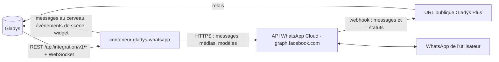
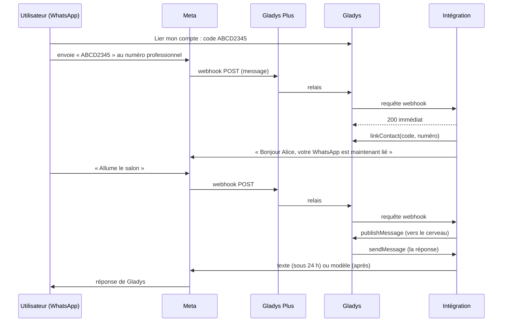
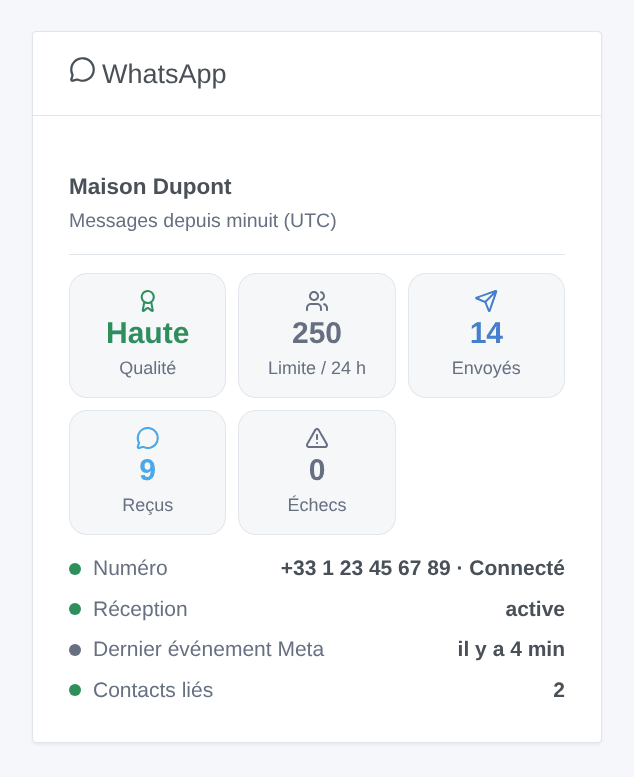

# Gladys WhatsApp

[English](README.md) · **Français** · [Deutsch](README.de.md) · [Español](README.es.md)

[](LICENSE)
[](https://github.com/William-De71/gladys-whatsapp/releases)
[](https://github.com/William-De71/gladys-whatsapp/actions/workflows/release.yml)
[](https://gladysassistant.com)


Intégration externe [Gladys Assistant](https://gladysassistant.com) pour **WhatsApp**, sur l'API officielle **WhatsApp Business Cloud** de Meta : écrivez à Gladys sur WhatsApp, recevez-y ses notifications et utilisez WhatsApp dans vos scènes. Contrairement à CallMeBot, elle fonctionne dans les deux sens : vos messages arrivent au cerveau de Gladys, qui vous répond sur WhatsApp.

Documentation utilisateur : [English](docs/en.md) · [Français](docs/fr.md) · [Deutsch](docs/de.md) · [Español](docs/es.md).

> Intégration communautaire, ni affiliée ni approuvée par Meta Platforms, Inc. ou WhatsApp LLC. Elle nécessite un compte WhatsApp Business sur l'API Cloud (une application Meta et un numéro professionnel) et, pour recevoir les messages, [Gladys Plus](https://gladysassistant.com/fr/plus/).

## Fonctionnalités

- **Discussion dans les deux sens** : chaque utilisateur de Gladys lie son numéro WhatsApp avec un code de liaison ; ses messages vont à Gladys, les réponses et notifications de Gladys reviennent sur WhatsApp (texte, et images avec légende).
- **Fenêtre de 24 heures gérée** : WhatsApp n'autorise le texte libre que dans les 24 heures qui suivent le dernier message de l'utilisateur. Au-delà, Gladys fait passer son message par un **modèle de secours** approuvé de votre choix, y compris quand Meta signale la fenêtre fermée après coup.
- **Réception via Gladys Plus** : Meta envoie les messages à l'URL de webhook Gladys Plus ; l'intégration répond elle-même à la vérification de Meta, écarte les doublons, marque les messages comme lus (coches bleues) et peut enregistrer l'URL chez Meta toute seule.
- **Sans Gladys Plus** : un bouton « Lier un numéro sans Gladys Plus » lie un numéro à la main, et Gladys envoie ses notifications via le modèle de secours (pas de réception).
- **Scènes** : déclencheurs « Message WhatsApp reçu » et « Message WhatsApp non remis », action « Envoyer un modèle WhatsApp ».
- **Widget de tableau de bord** : note de qualité et limite d'envoi du numéro, messages du jour, statut, réception, contacts liés.
- Bouton **Diagnostic** : ce que rapportent Meta et Gladys Plus, écrit dans les journaux avec le jeton, la clé et les numéros masqués.
- Anglais, français, allemand et espagnol partout.

## Fonctionnement




De la liaison à une réponse :



### Transport

Cloud uniquement (`transports: ["cloud"]`) : chaque message passe par les serveurs de Meta (`graph.facebook.com`), et les messages entrants par Gladys Plus. Le texte de vos échanges avec Gladys quitte donc votre réseau local ; c'est le fonctionnement de WhatsApp.

## Messages et fenêtre de 24 heures

| Situation                                       | Ce que Gladys envoie                                           |
| ----------------------------------------------- | -------------------------------------------------------------- |
| L'utilisateur a écrit il y a moins de 24 heures | Du texte libre (et des images)                                 |
| Plus de 24 heures, modèle de secours configuré  | Le modèle, avec le texte comme variable                        |
| Plus de 24 heures, pas de modèle de secours     | Du texte libre, refusé par Meta (« message non remis »)        |
| Meta refuse après coup (erreur 131047)          | Le modèle, une fois, s'il est configuré ; sinon le déclencheur |

Créez le modèle de secours dans WhatsApp Manager : catégorie **Utilitaire**, une variable dans le corps, par exemple `Gladys : {{1}}`. Meta interdit les retours à la ligne dans une variable : l'intégration les remplace par « · ».

## Déclencheurs, actions de scène et widget



- **Message WhatsApp reçu** (déclencheur) : un contact lié a envoyé un message. Filtres : types de message, charge utile du bouton, texte exact. Variables : numéro, nom du profil, utilisateur Gladys, type, texte, charge utile, latitude / longitude, emoji de réaction, identifiant du message.
- **Message WhatsApp non remis** (déclencheur) : premier échec pour un numéro (puis seulement après un succès), avec la cause (hors fenêtre, numéro absent de WhatsApp, modèle refusé, trop de messages, jeton refusé…).
- **Envoyer un modèle WhatsApp** (action) : un modèle approuvé vers un numéro ou vers tous les contacts liés, avec ses paramètres (`valeur1|valeur2` ou `nom=valeur`). Sorties : identifiant du message, identifiant WhatsApp, messages envoyés.
- Widget **WhatsApp** : nom vérifié, note de qualité, limite d'envoi, messages envoyés, reçus et en échec depuis minuit (UTC), statut du numéro, réception, dernier événement Meta, contacts liés.

Exemples :

- Quand le bouton « Ouvrir le portail » d'un modèle (charge utile `OPEN_GATE`) est touché → ouvrir le portail.
- Quand un contact lié partage sa position → la garder dans une variable, ou lancer le chauffage quand il approche.
- Quand l'alarme se déclenche → envoyer le modèle `alerte_alarme` à tout le monde (il arrive même hors de la fenêtre de 24 heures).

## Prérequis

- Gladys Assistant **5.1.0** ou plus récent (les instances plus anciennes ne peuvent pas installer l'intégration).
- Une application Meta de type Entreprise avec le produit WhatsApp, un numéro professionnel (ou le numéro de test de Meta, qui n'atteint que 5 numéros enregistrés) et un jeton permanent d'utilisateur système (`whatsapp_business_messaging`, `whatsapp_business_management`).
- **Gladys Plus** pour recevoir les messages (et pour lier les numéros avec un code envoyé sur WhatsApp).
- Les messages envoyés par une entreprise sont facturés par Meta selon sa grille (notamment les modèles hors fenêtre).

## Installation

- **Depuis le store** : Intégrations → WhatsApp → Installer.
- **Depuis l'URL du dépôt** : Intégrations → Ajouter une intégration externe → `https://github.com/William-De71/gladys-whatsapp`.
- **Mode développeur** : voir [Développement](#développement).

## Configuration

| Champ                                   | Rôle                                                                            |
| --------------------------------------- | ------------------------------------------------------------------------------- |
| Identifiant du numéro de téléphone      | Identifiant du numéro professionnel (WhatsApp → Configuration de l'API), requis |
| Jeton d'accès                           | Jeton permanent d'un utilisateur système (secret), requis                       |
| Identifiant du compte WhatsApp Business | Permet d'enregistrer le webhook et de lister les modèles                        |
| Jeton de vérification                   | Généré s'il est vide ; à coller chez Meta avec l'URL du webhook                 |
| Enregistrer le webhook                  | Diriger automatiquement le webhook du compte vers Gladys Plus (activé)          |
| Modèle de secours et langue             | Modèle utilisé hors de la fenêtre de 24 heures (ex. `gladys_notification`, fr)  |
| Marquer les messages comme lus          | Coches bleues (activé)                                                          |
| Langue des réponses                     | Réponses envoyées avant qu'un numéro soit lié                                   |

Ensuite, pour la réception : enregistrez votre clé Open API Gladys Plus dans le bloc **Webhooks Gladys Plus**, puis dans l'application Meta (WhatsApp → Configuration) collez l'URL du webhook et le jeton de vérification, et abonnez-vous au champ `messages`.

## Utilisation

1. Remplissez la configuration, puis cliquez sur **Tester la connexion**.
2. Dans **Lier mon compte**, générez un code et envoyez-le au numéro professionnel sur WhatsApp (ou, sans Gladys Plus, saisissez-le avec votre numéro dans **Lier un numéro sans Gladys Plus**).
3. Écrivez à Gladys sur WhatsApp ; ajoutez le widget à un tableau de bord et créez des scènes avec les déclencheurs et l'action.

## Développement

```bash
npm install
npm test                       # node --test, ne touche jamais le réseau
npm run lint                   # ESLint
npm run format:check           # Prettier
npx github:GladysAssistant/integration-store . --skip-image-check
scripts/build-cover.sh         # cover.jpg depuis docs/assets/cover.svg
docs/illustrations/render.sh   # docs/assets/widgets.<langue>.png
```

En local, le SDK lit `GLADYS_HOST_API_URL`, `GLADYS_INTEGRATION_TOKEN` et `GLADYS_INTEGRATION_SELECTOR` (fournis par Gladys en mode développeur). `DEBUG=gladys-integration-sdk` affiche les journaux du SDK.

Les tests couvrent le client de l'API Cloud (en-têtes, corps de la documentation Meta, codes d'erreur, images, textes longs, paramètres de modèle), la lecture des webhooks, l'état persistant, le widget (`validateWidgetContent`), le manifeste, les quatre langues, le script de release, et toute l'intégration face au faux Gladys du SDK et à une fausse API Cloud (liaison, réception, doublons, fenêtre de 24 heures, secours, échecs, action de scène, boutons). `test/structure.test.js` fige toutes les clés stockées chez l'utilisateur.

## Processus de release


Chaque fusion sur `main` lance la CI, puis calcule la version à partir des [Conventional Commits](https://www.conventionalcommits.org/fr/) depuis le dernier tag : `feat` → mineure, `fix` / `perf` → correctif, `!` ou `BREAKING CHANGE` → majeure (une mineure sous 1.0.0) ; `docs`, `chore`, `ci`, `test`, `style`, `refactor`, `build` seuls ne publient rien. La section du changelog est générée, le tag poussé, l'image multi-architecture construite, puis `main` reçoit le commit de release, la GitHub Release est créée et un dernier job vérifie l'image publique, le validateur du store et le topic.

- Le titre de la pull request devient le commit squash, puis la ligne du changelog : écrivez-le en anglais, pour l'utilisateur (`pr-title.yml` le vérifie). Ne modifiez jamais `CHANGELOG.md` à la main.
- La 1.0.0 est une décision : Actions → Release → Run workflow avec `release-as: 1.0.0`. `dry-run` affiche la version et les notes sans rien publier.
- **Branche protégée** : la release pousse son commit sur `main` avec `GITHUB_TOKEN`. Avec un ruleset sur `main`, ajoutez GitHub Actions à sa liste de contournement (ou poussez via une GitHub App), sinon le job de publication échoue avec les instructions.
- Après la première release, rendez le package `ghcr.io` public (Package settings → Change visibility), sinon Gladys ne peut pas le télécharger.

## Dépannage

Voir [docs/fr.md](docs/fr.md#dépannage). Signalez les problèmes avec les versions de Gladys et de l'intégration, votre installation (numéro de test ou réel, Gladys Plus ou non) et les lignes du bouton **Diagnostic**.

## Contribuer

Issues et pull requests bienvenues. Lancez `npm run format:check && npm run lint && npm test` avant d'ouvrir une pull request, et ne changez aucune clé stockée (voir [CLAUDE.md](CLAUDE.md)).

## Sécurité

Voir [SECURITY.md](SECURITY.md) : signalez les vulnérabilités en privé. Le jeton d'accès est un champ `secret`, envoyé uniquement dans l'en-tête `Authorization` vers `graph.facebook.com`, jamais journalisé. Gladys Plus ne relaie aucun en-tête HTTP, la signature `X-Hub-Signature-256` de Meta ne peut donc pas être vérifiée : le webhook est protégé par son URL, qui contient votre clé Open API Gladys Plus (une clé qui donne déjà le même accès à Gladys), par la vérification de l'identifiant du numéro et par les codes de liaison : seuls les contacts liés atteignent Gladys. Gardez l'URL du webhook secrète.

## Captures à venir

Les images ci-dessus sont des illustrations, pas des captures d'écran. Les vraies captures iront dans `docs/assets/screenshots/` (PNG, 1280 × 800) : `configuration.png`, `link-account.png`, `conversation.png` (une discussion WhatsApp avec Gladys, 1080 × 1920), `scene.png`.

## Licence

[Licence Apache 2.0](LICENSE) — voir aussi [NOTICE](NOTICE). WhatsApp et Meta sont des marques de Meta Platforms, Inc. ; cette intégration communautaire n'y est pas affiliée. Merci à la documentation et au SDK de Gladys.
