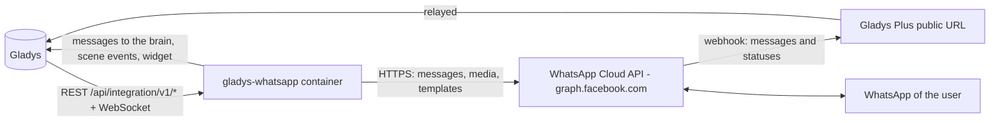
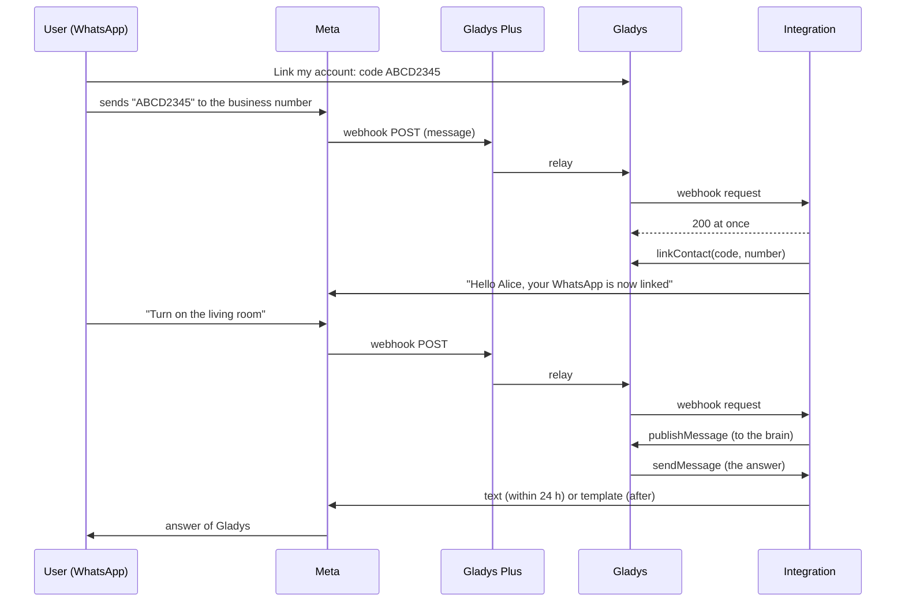
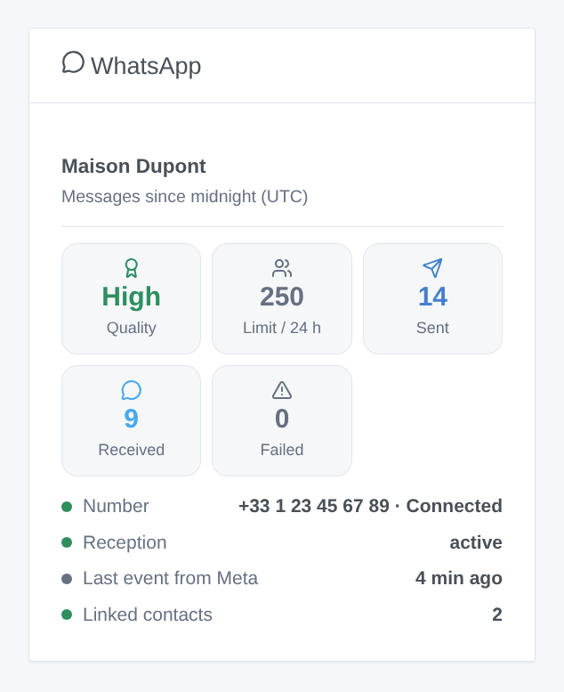

# Gladys WhatsApp

**English** · [Français](README.fr.md) · [Deutsch](README.de.md) · [Español](README.es.md)

[](LICENSE)
[](https://github.com/William-De71/gladys-whatsapp/releases)
[](https://github.com/William-De71/gladys-whatsapp/actions/workflows/release.yml)
[](https://gladysassistant.com)


[Gladys Assistant](https://gladysassistant.com) external integration for **WhatsApp**, on the official **WhatsApp Business Cloud API** of Meta: write to Gladys on WhatsApp, receive her notifications there, and use WhatsApp in your scenes. Unlike CallMeBot, it works both ways: the messages you send reach the brain of Gladys, which answers you on WhatsApp.

User documentation: [English](docs/en.md) · [Français](docs/fr.md) · [Deutsch](docs/de.md) · [Español](docs/es.md).

> Community integration, not affiliated with nor endorsed by Meta Platforms, Inc. or WhatsApp LLC. It needs a WhatsApp Business account on the Cloud API (a Meta app and a business phone number) and, to receive messages, [Gladys Plus](https://gladysassistant.com/plus/).

## Features

- **Two-way chat**: each Gladys user links their WhatsApp number with a link code; their messages go to Gladys, the answers and notifications of Gladys come back on WhatsApp (text, and images with a caption).
- **24-hour window handled**: WhatsApp only allows free text within 24 hours of the user's last message. Past that, Gladys sends its message through an approved **fallback template** of your choice, also when Meta reports the window closed after the fact.
- **Reception through Gladys Plus**: Meta posts the messages to the Gladys Plus webhook URL; the integration answers the verification of Meta itself, drops the duplicates, marks the messages as read (blue ticks) and can register the URL at Meta by itself.
- **Without Gladys Plus**: a "Link a number" button links a number by hand, and Gladys sends its notifications through the fallback template (no reception).
- **Scenes**: "WhatsApp message received" and "WhatsApp message not delivered" triggers, "Send a WhatsApp template" action.
- **Dashboard widget**: quality rating and messaging limit of the number, messages of the day, status, reception, linked contacts.
- **Diagnostic** button: what Meta and Gladys Plus report, written to the logs with the token, the key and the numbers masked.
- English, French, German and Spanish everywhere.

## How it works




From the link to an answer:



### Transport

Cloud only (`transports: ["cloud"]`): every message goes through the servers of Meta (`graph.facebook.com`), and the incoming ones through Gladys Plus. The texts of your conversations with Gladys therefore leave your local network; this is how WhatsApp works.

## Messaging and the 24-hour window

| Situation                                        | What Gladys sends                                    |
| ------------------------------------------------ | ---------------------------------------------------- |
| The user wrote less than 24 hours ago            | Free text (and images)                               |
| More than 24 hours, fallback template configured | The template, with the text as its variable          |
| More than 24 hours, no fallback template         | Free text, refused by Meta ("message not delivered") |
| Meta refuses afterwards (error 131047)           | The template, once, if configured; else the trigger  |

Create the fallback template in WhatsApp Manager: category **Utility**, one variable in the body, for example `Gladys: {{1}}`. Meta forbids line breaks in a variable: the integration replaces them with " · ".

## Scene triggers, actions and widget



- **WhatsApp message received** (trigger): a linked contact sent a message. Filters: message types, button payload, exact text. Variables: number, profile name, Gladys user, type, text, payload, latitude / longitude, reaction emoji, message ID.
- **WhatsApp message not delivered** (trigger): first failure for a number (then again only after a success), with the reason (outside the window, number not on WhatsApp, template refused, rate limit, token refused…).
- **Send a WhatsApp template** (action): an approved template to a number or to every linked contact, with its body parameters (`value1|value2` or `name=value`). Outputs: message ID, WhatsApp ID, messages sent.
- **WhatsApp** widget: verified name, quality rating, messaging limit, messages sent, received and failed since midnight (UTC), status of the number, reception, last event of Meta, linked contacts.

Examples:

- When the template button "Open the gate" (payload `OPEN_GATE`) is tapped → open the gate.
- When a linked contact shares their location → store it in a variable, or switch the heating on when they are close.
- When the alarm goes off → send the `alarm_alert` template to everyone (it reaches them even outside the 24-hour window).

## Requirements

- Gladys Assistant **5.1.0** or later (older instances cannot install the integration).
- A Meta app of type Business with the WhatsApp product, a business phone number (or the test number of Meta, which only reaches 5 registered numbers), and a permanent token of a system user (`whatsapp_business_messaging`, `whatsapp_business_management`).
- **Gladys Plus** to receive messages (and to link numbers with a code sent on WhatsApp).
- Messages sent by a business are billed by Meta according to its pricing (templates outside the window in particular).

## Installation

- **From the store**: Integrations → WhatsApp → Install.
- **From the repository URL**: Integrations → Add an external integration → `https://github.com/William-De71/gladys-whatsapp`.
- **Developer mode**: see [Development](#development).

## Configuration

| Field                          | Purpose                                                                    |
| ------------------------------ | -------------------------------------------------------------------------- |
| Phone number ID                | ID of the business number (WhatsApp → API Setup), required                 |
| Access token                   | Permanent token of a system user (secret), required                        |
| WhatsApp Business account ID   | Lets the integration register the webhook and list the templates           |
| Verify token                   | Generated when empty; to paste in Meta with the webhook URL                |
| Register the webhook           | Point the webhook of the account at Gladys Plus automatically (default on) |
| Fallback template and language | Template used outside the 24-hour window (e.g. `gladys_notification`, fr)  |
| Mark received messages as read | Blue ticks (default on)                                                    |
| Language of the replies        | Replies sent before a number is linked                                     |

Then, for the reception: save your Gladys Plus Open API key in the **Gladys Plus webhooks** block, and in the Meta app (WhatsApp → Configuration) paste the webhook URL and the verify token, and subscribe to the `messages` field.

## Usage

1. Fill in the configuration, then click **Test the connection**.
2. In **Link my account**, generate a code and send it to the business number on WhatsApp (or, without Gladys Plus, enter it with your number in **Link a number without Gladys Plus**).
3. Write to Gladys on WhatsApp; add the widget to a dashboard and build scenes with the triggers and the action.

## Development

```bash
npm install
npm test                       # node --test, never touches the network
npm run lint                   # ESLint
npm run format:check           # Prettier
npx github:GladysAssistant/integration-store . --skip-image-check
scripts/build-cover.sh         # cover.jpg from docs/assets/cover.svg
docs/illustrations/render.sh   # docs/assets/widgets.<lang>.png
```

Locally, the SDK reads `GLADYS_HOST_API_URL`, `GLADYS_INTEGRATION_TOKEN` and `GLADYS_INTEGRATION_SELECTOR` (given by Gladys in developer mode). `DEBUG=gladys-integration-sdk` shows the SDK logs.

The tests cover the Cloud API client (headers, payloads of the Meta documentation, error codes, images, long texts, template parameters), the parsing of the webhooks, the persisted state, the widget (`validateWidgetContent`), the manifest, the four languages, the release script, and the whole integration against the fake Gladys of the SDK and a fake Cloud API (link, reception, duplicates, 24-hour window, fallback, failures, scene action, buttons). `test/structure.test.js` freezes every key users store.

## Release process


Every merge on `main` runs the CI, then computes the version from the [Conventional Commits](https://www.conventionalcommits.org/) since the last tag: `feat` → minor, `fix` / `perf` → patch, `!` or `BREAKING CHANGE` → major (a minor below 1.0.0); `docs`, `chore`, `ci`, `test`, `style`, `refactor`, `build` alone publish nothing. The changelog section is generated, the tag pushed, the multi-architecture image built, then `main` receives the release commit, the GitHub Release is created and a last job checks the public image, the store validator and the topic.

- The pull request title becomes the squash commit, then the changelog line: write it in English, for the user (`pr-title.yml` checks it). Never edit `CHANGELOG.md` by hand.
- 1.0.0 is a decision: Actions → Release → Run workflow with `release-as: 1.0.0`. `dry-run` shows the version and the notes without publishing.
- **Protected branch**: the release pushes its commit to `main` with `GITHUB_TOKEN`. With a ruleset on `main`, add GitHub Actions to its bypass list (or push through a GitHub App), otherwise the publish job fails with instructions.
- After the first release, make the `ghcr.io` package public (Package settings → Change visibility), or Gladys cannot pull it.

## Troubleshooting

See [docs/en.md](docs/en.md#troubleshooting). Report issues with the versions of Gladys and of the integration, your setup (test or real number, Gladys Plus or not) and the lines of the **Diagnostic** button.

## Contributing

Issues and pull requests are welcome. Run `npm run format:check && npm run lint && npm test` before opening a pull request, and keep every stored key unchanged (see [CLAUDE.md](CLAUDE.md)).

## Security

See [SECURITY.md](SECURITY.md): report vulnerabilities privately. The access token is a `secret` field, sent only in the `Authorization` header to `graph.facebook.com`, never logged. Gladys Plus relays no HTTP header, so the `X-Hub-Signature-256` signature of Meta cannot be checked: the webhook is protected by its URL, which contains your Gladys Plus Open API key (a key that already gives the same access to Gladys), by the check of the phone number ID, and by the link codes: only linked contacts reach Gladys. Keep the webhook URL secret.

## Screenshots to come

The images above are illustrations, not screenshots. Real screenshots will go in `docs/assets/screenshots/` (PNG, 1280 × 800): `configuration.png`, `link-account.png`, `conversation.png` (a WhatsApp chat with Gladys, 1080 × 1920), `scene.png`.

## License

[Apache License 2.0](LICENSE) — see also [NOTICE](NOTICE). WhatsApp and Meta are trademarks of Meta Platforms, Inc.; this community integration is not affiliated with it. Thanks to the Gladys documentation and SDK.
